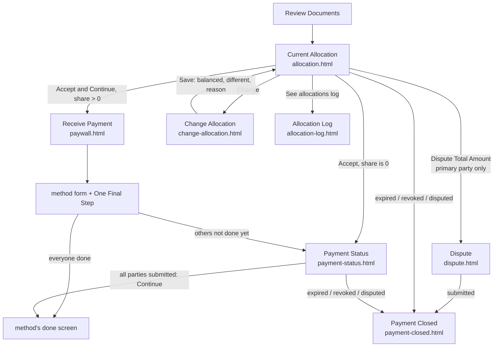

# SMART Disburse — US Multi-Party flow

One payment is shared between several **co-payees** (parties), for example an insurance claim paid to a homeowner
and their contractors. Each party agrees to the **allocation** (who gets how much), then picks how to receive their
own share. Entry: `src/pages/onboarding/index.html?flow=multi-party`.

It's the [US Default flow](us-default.md) with one extra step, **Current Allocation**, between Review Documents and
Receive Payment, plus a waiting screen while the other parties finish. Code: `src/scripts/onboarding-flow.js` (state,
routing) and `src/scripts/onboarding-multi-party.js` (screens). Documents come from `src/data/sd-documents-mp.json`.

## Flow map

## Screens

| Screen | File | What it shows and does |
|---|---|---|
| Current Payment Allocation | `allocation.html` | Amount to be allocated, each party and their share with an accepted / pending pill, who created the allocation and when, the expiry chip, **How it works**. Actions: **Accept and Continue**, **Change**, **Dispute Total Amount** (primary party only), "See allocations log" once there's history. A **New Allocation** dialog appears when someone else changed the split |
| Change Allocation | `change-allocation.html` | An amount per party (the user first) and a required reason. Live total: green "Total amount allocated", amber "$x left to allocate", or red "Over-allocated by $x" |
| Allocation Log | `allocation-log.html` | Every allocation, newest first: author, time (ET), comment, amounts |
| Payment Status | `payment-status.html` | After the user submits: their amount, estimated processing time (Instant / Up to 3 Days / 7–10 Days), the expiry countdown, each party submitted or waiting. Once everyone has submitted: "Your payment is being processed." and **Continue** to the done screen. A $0 share shows the status without an amount card |
| Dispute | `dispute.html` | Form: first and last name, company (optional), email, phone, message (max 255) |
| Payment Closed | `payment-closed.html` | Expired, revoked or disputed: icon, title, Reason and Details (Expired On, Issued To), the client's contact card |

## Rules

| Rule | Detail |
|---|---|
| Who can dispute | Only the **primary party**. A dispute cancels the payment request for everyone |
| Accepting | Accepting the current allocation records it for the user. A share of $0 skips the payment method and goes to Payment Status |
| Changing | The parties must add up exactly to the total; the split must differ from the current one ("Allocation amount is the same as previous"); a reason of at least 10 characters is needed. A new allocation **resets everyone's acceptance** |
| Waiting | Submitting a method goes to Payment Status until every other party has submitted; then on to the method's done screen |
| Expiry | Badge by time left: more than a day, gray with the date; under 24 h, amber "Expires in 17 hours"; under 1 h, red with a live seconds countdown |
| Fallback check | When the payment expires or is revoked (not when disputed), the **whole payment is issued to the primary party** ("Issued To: … (Primary Party)"); the others are told to contact the client about their share. TODO(confirm): which method the fallback uses (Figma "[MOP] will be issued to [Primary Party]") |
| Revoked reason | "Too many failed attempts to provide answer to security question(s) by [party]" |

## States

Payment (whole request): **active**, **expired**, **revoked**, **disputed**.
Party: **pending** (hasn't accepted), **accepted**, **submitted** (chose a method).
Allocation: a log of entries (initial plus each change), each with its own set of acceptances.

## Prototype notes (not product)

- **Demo data.** Total $15,000.00; parties Leonard Krasner (you), Johnny Anderson, Leslie James, Maria Lopez, David Chen. All are sample names.
- **Scenario switcher** (button bottom right):
  - **Role:** primary or other party
  - **Party count:** 2, 3 or 5
  - **Allocation:** nobody accepted / others accepted / your share is $0
  - **Payment:** active / expired / revoked / disputed
  - **Fallback check:** yes / no
  - **Expiry:** days / hours / minutes
  - **On Payment Status:** others still choosing / some / all submitted
  - **Buttons:** "Someone changes the allocation" and "Reset scenario"
- **State is per browser tab.** It's kept in `sessionStorage` (`sd-mp-state`). Opening `?flow=multi-party` starts a fresh demo.
