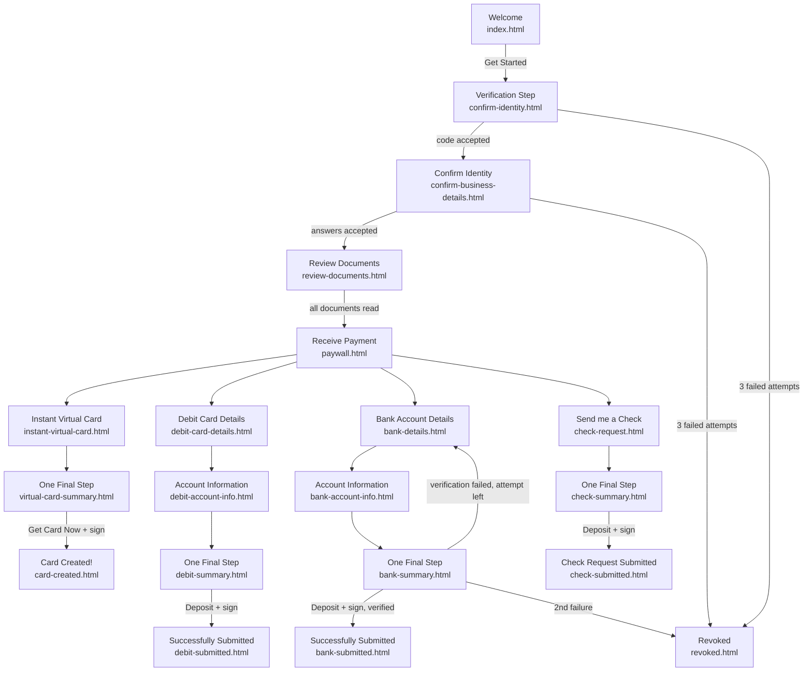

# SMART Disburse — US Default flow

The single-payee flow. Entry: `src/pages/smart-disburse/index.html` → `src/pages/onboarding/index.html?flow=us`.
Rules shared by both flows (validation, attempts, consents) are on [standard.md](../standard.md#business-rules).

## Flow map

Not drawn above, to keep the map readable:
- **Decline Payment** (sidebar / mobile menu) is available on every screen until a method is submitted → `declined.html`.
- **Switching methods:**
  - bank form → debit card ("Route using my debit card number")
  - debit card form → bank ("I'd rather use my routing and account number")
  - card and check forms → bank ("I'd rather send it directly to my bank account")
- **"I want my money faster!"** on the bank and check summaries → Instant Virtual Card or debit card.

## Screens

| Screen | File | Step | What the payee does | Next |
|---|---|---|---|---|
| Welcome | `index.html` | — | Greeting "[sender] is enhancing the way they will be paying you", amount; **Learn more**, **Get Started** | Verification |
| Verification Step | `confirm-identity.html` | 1 | Tick "I agree to receive verification codes", **Request Code**, enter the 6-digit code, **Submit Code**. Shows the masked email or phone, a countdown, and "Request New Code" when expired | Confirm Identity, or Revoked |
| Confirm Identity | `confirm-business-details.html` | 2 | "Let's make sure it's you!": claim number, last 4 of SSN, mailing ZIP. A wrong answer shows a red card and the attempts left | Review Documents, or Revoked |
| Review Documents | `review-documents.html` | 3 | Open each document in the viewer ("n of N", Download, Previous / Next / Done); reviewed ones get a green check | Receive Payment |
| Receive Payment | `paywall.html` | 4 | Amount card (from sender), chips **Message** / **Expiration** / **Contact Us**, then pick a method | Method form |
| Instant Virtual Card | `instant-virtual-card.html` | 4 | Personal, address and contact details (prefilled from the payee); **How this works** sample card | Summary |
| Debit Card Details | `debit-card-details.html` | 4 | Name on card, card number (brand chip), MM / YY; fee shown | Account Information |
| Bank Account Details | `bank-details.html` | 4 | Account type, holder name, routing and account numbers; "Can't find…?" opens sample-check help | Account Information |
| Account Information (bank / debit) | `bank-account-info.html`, `debit-account-info.html` | 4 | "Review Account Information": address, date of birth, SSN, contact | Summary |
| Send me a Check | `check-request.html` | 4 | Same form as the card: name, mailing address, contact | Summary |
| One Final Step | `virtual-card-summary.html`, `bank-summary.html`, `debit-summary.html`, `check-summary.html` | 4 | Review with Edit links, three consents, then **Get Card Now** / **Deposit $amount** → sign dialog. Bank and check offer **I want my money faster!** | Done screen |
| Card Created! | `card-created.html` | 5 | Virtual card (reveal number, CVC, expiry), receipt, **How to use this card**, Trademark Disclaimer, **Download Receipt** (optional email), **Finish and Close** | End |
| Successfully Submitted! | `bank-submitted.html`, `debit-submitted.html` | 5 | Amount, receipt with the account or card, Download Receipt, Finish and Close | End |
| Check Request Submitted! | `check-submitted.html` | 5 | Check request, **How this works**, Finish, Download / Share Receipt | End |
| Declined | `declined.html` | — | "Your SMART Disburse access has been revoked" heading, the reason given, client contact card | End |
| Revoked | `revoked.html` | — | "Unfortunately, your payment was revoked.", who failed and why, client contact card, payment reference | End |

Present on every step:
- **Sidebar:** Contact Us dialog, Decline Payment, language (English), Terms of Use / Privacy Policy / E-Sign Consent, "Powered by Transcard".
- **Mobile:** a top bar with the current step and progress; the menu holds Contact / Decline.

## Figma references (from code comments)

| Screen | Node | Screen | Node |
|---|---|---|---|
| Verification Step | 19447:65397 | Bank details | 19555:31325 |
| Confirm Identity | 19468:87018 | Bank account information | 19555:47201 |
| Review Documents | 19468:87528 | Bank summary / final attempt | 19555:80882 / 21226:91915 |
| Receive Payment | 19484:89366 | Bank submitted | 19555:96979 |
| Virtual Card form | 19484:94823 | Check request / summary / submitted | 20322:74110 / 20322:74705 / 20325:93858 |
| Virtual Card summary | 19484:101062 | Debit card details | 21923:104799 |
| Card Created | 19484:120301 | Get your money faster | 20370:56952 |
| Sign dialog | 19484:111910 | Decline dialog | 20211:43257 |
| Sidebar ("SD Menu") | 19427:30373 | Contact dialog | 19652:53918 |

TODO(confirm): which Figma file these nodes belong to. [LAUNCHED] Default Flow is the likely one: see
[figma-files.md](../../../design-system/figma-files.md).
