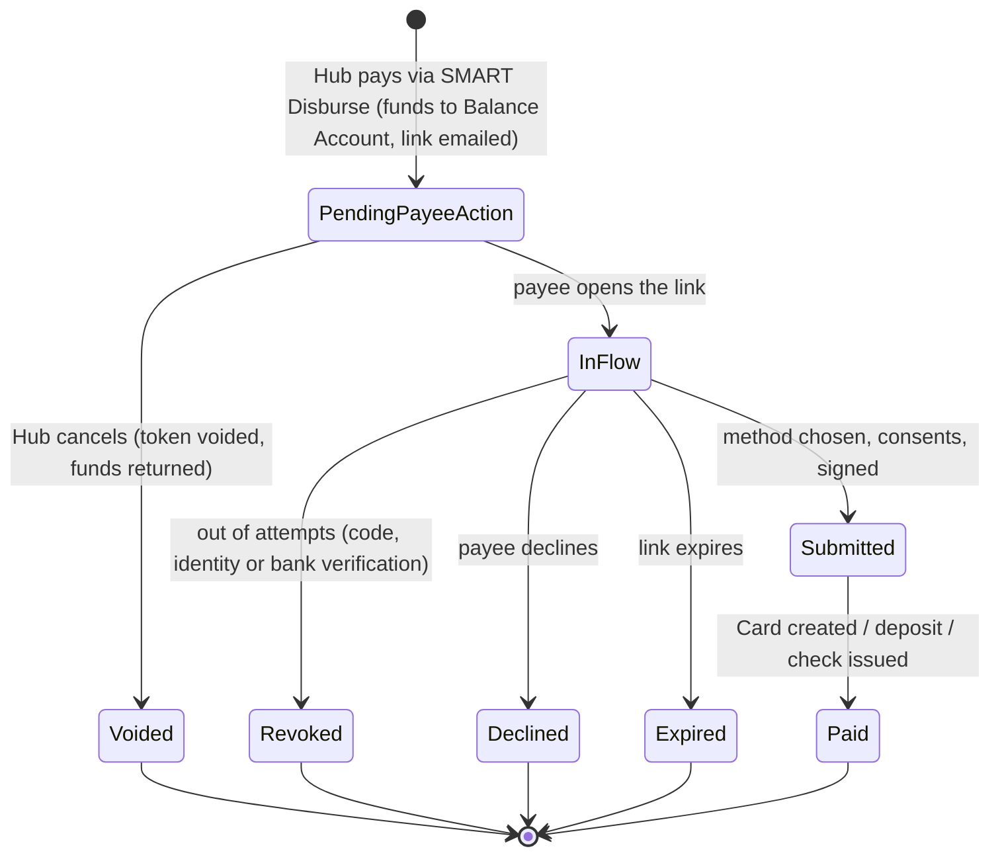

# SMART Disburse — current standard (R3)

The latest standard on `main`. Client differences are **not** here; see [variants/](variants/README.md).

SMART Disburse is the **payee's** side of a payment sent from SMART Hub AP. The payee, a **claimant** or a **supplier**
(both use the same flow), opens a
secure link, proves who they are, reviews the claim documents, and chooses how to receive the money. There's no
account and no portal: it's a single guided flow in the [Token flow layout](../../suite/layouts.md#3-token-flow-disburse-collect).

There are two flows:

| Flow | Who | Detail page |
|---|---|---|
| **US Default** (single payee) | One payee receives the whole payment | [flows/us-default.md](flows/us-default.md) |
| **US Multi-Party** | A payment shared between co-payees; each accepts the split, then picks their own method | [flows/multi-party.md](flows/multi-party.md) |

## How a payee gets here

1. In **Hub → Pay**, the payer chooses **SMART Disburse** as the payment method and adds the payee's email address(es).
2. Funds move from the origination account to a **Balance Account**, and Hub shows the payable as **Pending Payee Action**.
3. An email with the secure link is sent (test backend: `workers/sd-sx-token-service`, see [integration I-04](../../suite/integrations.md)).
4. The link opens `src/pages/onboarding/index.html`, the **Welcome** screen. It shows the payee's name, the amount, the sender, and **Get Started**.

Cancelling in Hub **voids the token** and returns the funds from the Balance Account to the origination account.

## Steps

The left **step rail** (mobile: the top bar) shows these steps. Source: `src/data/onboarding-steps.json`, with a copy in
`src/scripts/onboarding-stepper.js` that must be kept in sync.

| # | Step | Screens | Purpose |
|---|---|---|---|
| 1 | **Verification Step** | `confirm-identity.html` | One-time code by email or phone |
| 2 | **Confirm Identity** | `confirm-business-details.html` | Security questions: claim number, last 4 of SSN, mailing ZIP |
| 3 | **Review Documents** | `review-documents.html` | Open and read every claim document |
| — | **Current Allocation** *(Multi-Party only)* | `allocation.html`, `change-allocation.html`, `allocation-log.html`, `dispute.html` | Accept, change or dispute the split |
| 4 | **Receive Payment** | `paywall.html`, then the chosen method's form and **One Final Step** summary | Choose how to be paid; consents; sign |
| 5 | **Complete Payment** | `card-created.html`, `bank-submitted.html`, `debit-submitted.html`, `check-submitted.html` (Multi-Party: `payment-status.html` first) | Confirmation and receipt |

Screen-by-screen detail: [US Default flow](flows/us-default.md#screens).

## Payment methods

Offered on **Receive Payment** (`paywall.html`, from `src/data/sd-payment.json`), in this order:

| Method | Label | Speed shown | Form → Summary → Done | Notes |
|---|---|---|---|---|
| Instant Virtual Card | "Instant Virtual Card" | Funds expected instantly | `instant-virtual-card.html` → `virtual-card-summary.html` → `card-created.html` | Card number / CVC / expiry revealed on the done screen; "How to use this card" |
| Debit card | "Send to my Debit Card" | Funds expected instantly | `debit-card-details.html` → `debit-account-info.html` → `debit-summary.html` → `debit-submitted.html` | Fee shown on the form (`sd-debit.json` `fee`, 2.50). TODO(confirm): fee rule. Mastercard / Visa detected |
| Bank account (ACH) | "Send to my Bank Account" | Expected from instantly up to 3 days | `bank-details.html` → `bank-account-info.html` → `bank-summary.html` → `bank-submitted.html` | Bank account is verified when depositing; see rules |
| Check | "I want a check" | (Slowest payment method) | `check-request.html` → `check-summary.html` → `check-submitted.html` | Mailing address form |

Switching paths:
- **From the bank form to the debit card:** "Route using my debit card number".
- **From the debit card form to the bank:** "I'd rather use my routing and account number".
- **From the card and check forms to the bank:** "I'd rather send it directly to my bank account".
- **"I want my money faster!"** appears on the bank and check summaries. It offers the Virtual Card or a debit card instead (`src/data/sd-faster.json`).

Each **One Final Step** summary has:
- the details, grouped, with **Edit** links
- three consents: Terms of Use for SMART Suite, Privacy Policy, Consent to Electronic Communications (E-Sign)
- a primary button that unlocks once all three are accepted: **Get Card Now** (Virtual Card) or **Deposit $amount**
- **Sign to authorize payment**: a dialog where the payee draws or types their signature, then sees "We're processing your request".

## Business rules

| Area | Rule | Source |
|---|---|---|
| Verification code | 6 digits, valid 120 s; "Request New Code" unlocks when it runs out. **3 attempts**: each wrong or expired code uses one; none left → **Revoked** ("Exhausted attempts to provide Verification Code"). The channel (email / phone) comes from the data; the link can override it with `?channel=email` or `?channel=phone` | `sd-verification.json`, `confirm-identity.js` |
| Identity questions | Claim number (1–12), last 4 of SSN (4), mailing ZIP (5–6). Next is enabled only when all are complete. **3 attempts**; none left → **Revoked** ("Exhausted attempts to confirm identity") | `sd-identity.json`, `confirm-business-details.js` |
| Documents | Every document must be opened and read to the end (Next in the viewer marks it done) before the step's Next continues. Missing ones turn red. Resets on reload | `sd-documents.json` / `sd-documents-mp.json`, `review-documents.js` |
| Account information (card, bank, debit, check forms) | Masks: date of birth MM-DD-YYYY, SSN, phone +1 (555) 000-0000, 5-digit ZIP; allowed characters; US states only | `virtual-card.js`, `sd-virtual-card.json` |
| Bank details | Account type (Checking / Savings), holder name, routing number (9 digits, bank name shown when recognised), account number (1–17 digits) entered twice and must match | `bank-details.js`, `sd-bank.json` |
| Bank verification | Runs on **Deposit**: the holder name must match the payee, or "Doesn't match your bank's records"; an account that can't be found shows "Unable to verify bank account". **2 attempts**, the second marked "Final attempt"; then **Revoked** | `onboarding-bank.js`, `bank-summary.js` |
| Debit card | Name, card number (Luhn check, grouped in fours), MM / YY (month 01–12, not expired). An invalid or declined card shows "provided debit card details are invalid" | `debit-card.js`, `sd-debit.json` |
| Consents | Each consent opens its text; **Accept** unlocks after scrolling to the end; unticking withdraws it | `onboarding-consents.js` |
| Decline | **Decline Payment** (sidebar / mobile menu) at any step before completion. Pick a reason from `sd-decline.json`; "Other" needs a note of 10–255 characters → **Declined** screen | `onboarding-decline.js` |
| Expiry | The payment has an expiration date (`sd-payment.json` `expirationDate`), shown under the **Expiration** chip | `paywall.js` |

## Statuses and lifecycle

| State | Payee sees | Hub sees |
|---|---|---|
| Pending Payee Action | Welcome → steps | "Pending Payee Action" (purple badge); Cancel available |
| Revoked | `revoked.html`: "Unfortunately, your payment was revoked.", who failed, client contact card, payment reference | TODO(confirm): not wired back to Hub in the prototype |
| Declined | `declined.html`: the reason and note given, client contact card | TODO(confirm): not wired back to Hub in the prototype |
| Expired (Multi-Party) | `payment-closed.html`: "Your SMART Disburse request has expired" | TODO(confirm) |
| Submitted / Paid | Method's done screen with receipt (Download / Share) | TODO(confirm): Hub moves the payable on its own schedule; there's no callback in the prototype |

Multi-Party adds party-level states (accepted, submitted, disputed): [flows/multi-party.md](flows/multi-party.md#states).

## Prototype notes (not product)

- **Demo data.** Payable, payee, amount ($487.00) and sender ("Horizon Inc.") come from Hub's sample data (`bills-payables.json`, `payees.json`) through `src/scripts/sd-onboarding-context.js`. URL parameters `payableId`, `bill`, `payeeId`, `sender` and `email` pick a different payable or payee.
- **Demo triggers.**
  - Verification code `000000` is always wrong.
  - Identity answers made only of zeros are wrong.
  - Bank account `1111111111` can't be verified.
  - Debit card `4000000000000002` is declined.
- **State is browser-only.** Flow choice, Multi-Party state and form answers are kept in `sessionStorage` / `localStorage`: `sd-flow`, `sd-mp-state`, `sd-onboarding-state`. Clear them to restart.
- **Multi-Party Scenario switcher.** The **Scenario** button, bottom right on Current Allocation, Payment Status and Payment Closed, sets role, party count, allocation, payment state and expiry. Demo only.
- **Legacy screens off the main path.** `signature.html`, `summary.html`, `create-account.html` and `complete.html` aren't linked from the current flow, and signing happens in a dialog on each summary. The stepper's **Complete Payment** step still points to `create-account.html`. TODO(confirm): remove or keep.
- **Loading skeletons.** Every step fades in and masks its data for 1.0–1.5 s to simulate loading (`onboarding-transitions.js`).

## Known limitations

- No backend: nothing the payee does is sent back to Hub.
- The token email link uses `?flow=sd` (`workers/sd-sx-token-service/src/index.js`), but the flow only recognises `us` and `multi-party`, so an emailed link opens whichever flow that browser tab last used. TODO: align.
- English (United States) is the only language in the language picker.
