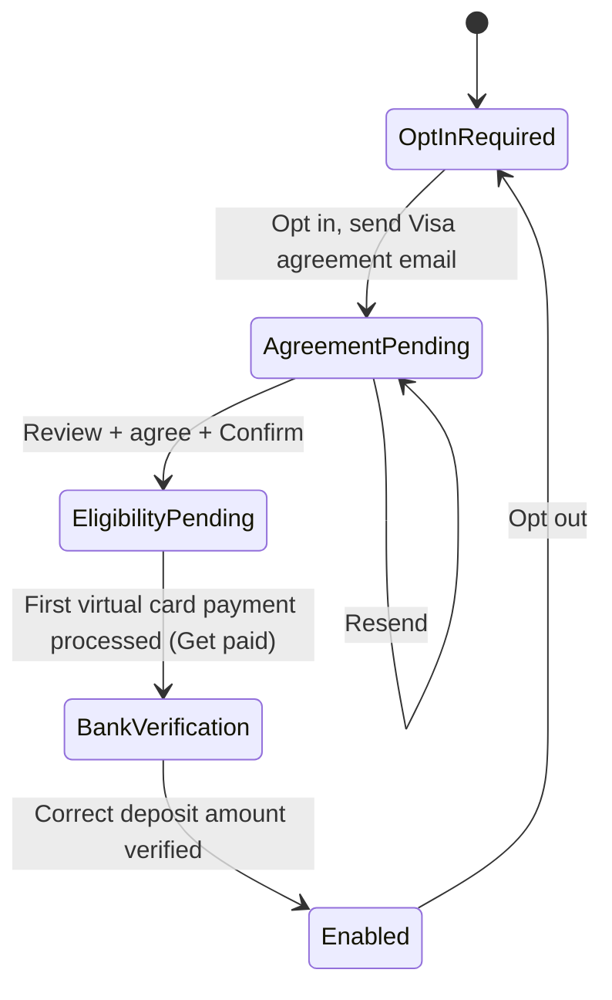

# SMART Exchange — current standard (R3)

Describes the latest standard version on `main`. Client differences are **not** here; see [variants/](variants/README.md).

## Capabilities
TODO: what users can do, grouped by area.

## Screens / steps
TODO: main screens (portal) or steps (flow), each with one line on its purpose.

## Automatic Card Processing (STP)

Lets a supplier have eligible virtual card payments processed automatically through their own
merchant processor, instead of keying each card in by hand from **Get paid**.

**Where it shows:** a card in **Payment Preferences → Payment Methods → Payers' Cards**
(`src/pages/dashboard/payment-preferences.html`) and a banner inside the Portal top bar on every
page (`src/scripts/topbar-component.js`). Plans with `hideStp` (the Consumer Portal) never show it.

**State:** one global value per browser, `localStorage` key `sx_global_stp_state_v3`, owned by
`src/scripts/stp-state.js` (`window.STPState`). Prototype only, there is no backend.

### Steps

| `stpStatus` | `stpStep` | Card badge | Top bar banner | User action |
|---|---|---|---|---|
| `disabled` | `opt_in_required` | none | "Interested in Automated Card Processing?" | **Opt in** |
| `in_progress` | `agreement_signature_pending` | Pending Agreement Signature | "Visa Agreement Signature Pending", with the email and send time | **Review** (sign the agreement) |
| `in_progress` | `terminal_completed_tid_mid_received` | Pending | "Let's Confirm Eligibility for Automatic Card Processing" | Process a pending virtual card payment in Supplier Portal |
| `in_progress` | `bank_verification_required` | Action Required | "Action Required" (yellow) | **Verify now**: confirm the small deposit amount |
| `enabled` | `completed` | Enabled | none | "Changed payment processors, need to reverify…" link; **Opt out** in the card menu |

### Flow

### Date columns

Pending, Action Required: no date · Paid: **Date Processed** · Exceptions: **Date Initiated**. Rules: [table filter → Date columns per portal](../../design-system/table-filter.md#date-columns-per-portal).
Date Processed is the payment's "complete" activity event (`getDateProcessedIso`).

## Table filter

Uses the shared filter ([design-system/table-filter.md](../../design-system/table-filter.md), [decision 0002](../../decisions/0002-shared-table-filter.md)):
same layout and behavior as every portal. Categories come from this table’s column headers.
Current categories and gaps: [SMART Exchange: Payments](../../design-system/table-filter.md#smart-exchange-payments-supplier-portal).

## Business rules

- **Visa agreement email.** Sent through the token service (`workers/sd-sx-token-service`). Only
  addresses in `allowedTestEmails` (`src/data/public-runtime-config.json`) get a real email. Any other
  address still moves STP to *Agreement pending*, sends nothing, and the banner says "Test mode, no
  email delivered to …".
- **Agreement link.** The email links back to Payment Preferences with `?stpAgreement=review`, which
  opens the agreement dialog.
- **Bank verification** is reached from Supplier Portal: processing a card payment from **Get paid**
  (`src/scripts/exchanges-table.js`) sets `bank_verification_required`.
- **Opt out** is in the card menu (⋮), which shows only at *Bank verification* and *Enabled*. It
  returns STP to `opt_in_required`.

### Design decisions

Confirmed with design on 2026-10-20.

- **Go to Payments guide.** The Supplier Portal guide (`?guide=card-rows`) dims the screen and
  highlights the card rows and their **Get paid** buttons. That is intended: it is the visual cue
  that the supplier has to process a payment through **Get paid**.
- There is no "Generic pending" step. An earlier draft listed one; design found no such frame.

### Open questions

- **Re-verify link.** What "Changed payment processors, need to reverify…" should do is not
  defined, because design has not decided what changing processors means for the UI. Until then it
  opens the setup steps dialog. TODO(design).

## Business rules
TODO: rules that are easy to get wrong (limits, approvals, validation, statuses).

## Statuses and lifecycle
TODO: e.g. payment / enrollment / token statuses and transitions.

## Known limitations
TODO
