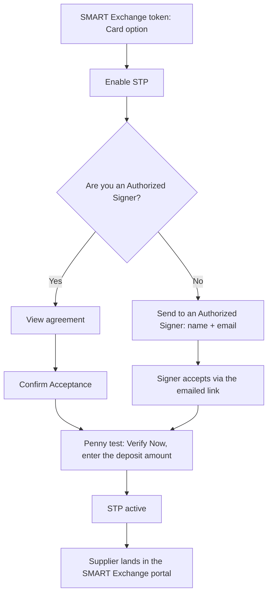
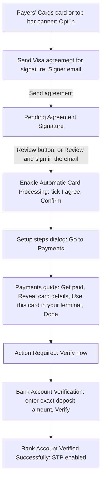
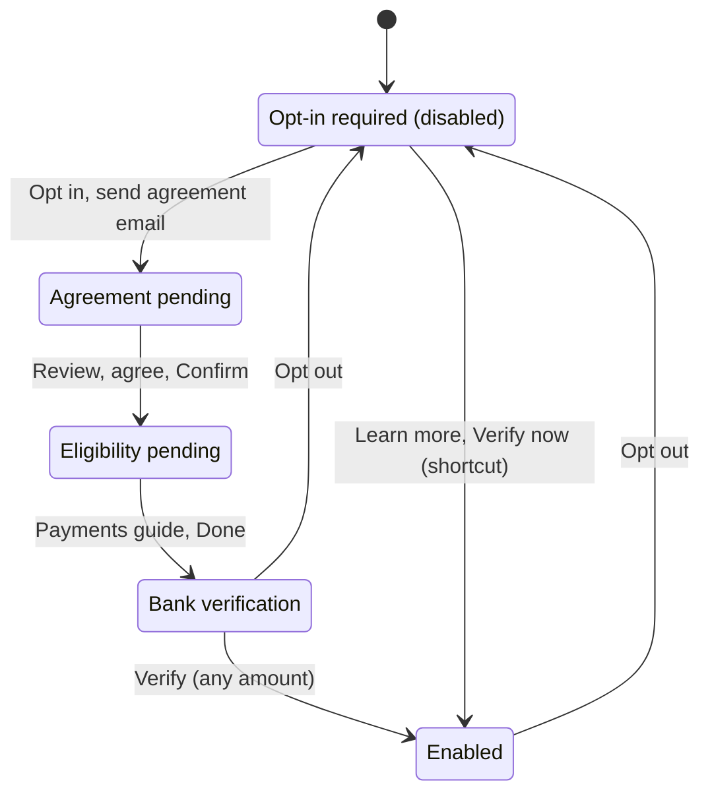

# STP (Automatic Card Processing)

**STP** ([Straight Through Processing](../../suite/glossary.md)) is called **Automatic Card Processing** in the UI.
Rules shared with the rest of SMART Exchange are on [standard.md](standard.md).

## What it is and who it's for

STP is a **card** option for **suppliers** (businesses) that have their own
[card processor](../../suite/glossary.md) (for example a Visa-based merchant processor) and a
[merchant account](../../suite/glossary.md). With STP on, card payments sent to the supplier on that rail are processed
automatically to their merchant account, so nobody has to key the card in by hand from **Get paid**.

- **Visa only, for now** (product owner, 2026-11-05). The agreement in the code is the **Visa AR Manager Participation
  Agreement**. The "[WIP] STP - Mastercard" Figma file is not part of the current scope.
- Payers (SMART Hub) and consumers (Consumer Portal) don't opt in to STP. See [where it appears](#where-it-appears).

## Where it appears

| Place | What the supplier sees | Code |
|---|---|---|
| **SMART Exchange token flow**, Card option | An **enable STP** option under **Card**, then the Authorized Signer question. When the flow is complete, the supplier **lands in the SMART Exchange portal**. Designed in Figma [R3] SMART Exchange, page STP; **not built** in the prototype, see [below](#the-token-flow-is-not-built) | — (Figma only) |
| **SX portal: Payment Preferences → Payment Methods → Payers' Cards** | The **Automatic Card Processing** card: status badge, description, **Opt in** / **Review** / **Learn more** button, ⋮ menu (Learn more, Opt out), the yellow "confirm the small deposit amount" alert, and the re-verify link | `src/pages/dashboard/payment-preferences.html` (`#pp-stp-card-container`), `src/scripts/pages/payment-preferences-page.js` |
| **SX portal: top bar banner**, on every Portal page | One banner per state, between the greeting row and the breadcrumbs | `src/scripts/topbar-component.js` (`_renderAlerts`, `bindStp`) |
| **SX portal: Payments** (`supplier-portal.html?guide=card-rows`) | A guide that highlights the card rows and **Get paid**, used for the "Process Any Payment" step | `src/scripts/exchanges-table.js` (action column guide) |
| Dialogs on any other Portal page | Fallback copies of the agreement, setup-steps, verify and success dialogs, built by the store when the page has none of its own | `src/scripts/stp-state.js` (`ensureInline…Dialog`) |

**Not shown:**
- **Consumer Portal:** its plan sets `hideStp: true` (`src/scripts/app-plans.js`), so the top bar never shows the
  banner, and `consumer-payment-preferences.html` has no STP card. It still carries unused copies of the STP dialogs
  ([D-39](../../design-system/portal-consistency.md#stp-found-2026-11-05)).
- **SMART Hub (payer side):** no Hub script reads STP state. Payers see nothing about a supplier's STP. But the
  banner only checks `hideStp`, so it **does** show in the Buyer view (`bills-payables` plan) and in the Transcard
  view ([D-37](../../design-system/portal-consistency.md#stp-found-2026-11-05)).

### The token flow is not built

There are no STP screens in the token-flow shell (`src/pages/onboarding/`). Hub Pay can send a SMART Exchange test token
email (`src/scripts/payables-pay.js`, `flow: "sx"`), and the token service links it to
`src/pages/onboarding/index.html?flow=sx`. But `onboarding-flow.js` only knows `us` and `multi-party`, so the link opens
the SMART Disburse screens. There is no SX-specific screen, no Card option with STP, and no Authorized Signer step.
The token-flow screens are designed in Figma **[R3] SMART Exchange, page STP**
([Figma](https://www.figma.com/design/9DRzbyv7FDCDYFYN5ZGuwZ)). That is their source of truth (product owner,
2026-11-05). This page describes them from the product owner's description, because the Figma page hasn't been read
here yet. TODO: add screen-level detail from Figma.

## Opt-in flow

### As described by the product owner (token flow)

Designed in Figma [R3] SMART Exchange, page STP; not built in the prototype.

The terminal step (TID/MID) also happens after signing, but it runs outside the UI and adds no screen. See
[Eligibility (terminal) step](#eligibility-terminal-step).

### As built in the SX portal

The portal has **no Authorized Signer question**. Whoever opts in always sends the agreement by email, and anyone who
can open the portal can then press **Review** and accept it. **This stays as is** (product owner, 2026-11-05): the
Authorized Signer question belongs to the token flow only. The portal also shows a **Process Any Payment** (terminal)
step between the agreement and the penny test. See [Code vs product owner](#code-vs-product-owner).

### Steps

Steps 1 to 3 come from the product owner only. Steps 4 to 10 are what Payment Preferences does today.

| # | Screen or dialog | What the user does | Fields and validation | What happens next |
|---|---|---|---|---|
| 1 | Token flow: payment method, **Card** | Turns on **enable STP** | See Figma [R3] SMART Exchange, page STP | Authorized Signer question. *Not built* |
| 2 | Token flow: **Authorized Signer?** | Answers Yes or No | Yes / No. Detail in Figma | Yes → agreement (step 3). No → send to a signer (name + email). *Not built* |
| 3 | Token flow: **agreement** | Views the agreement, **Confirm Acceptance** | Detail in Figma | Penny test, then the supplier lands in the SX portal. *Not built* |
| 4 | Payment Preferences, **Automatic Card Processing** card, or the blue banner | **Opt in** | — | Step 5 |
| 5 | **Send Visa agreement for signature** (`#pp-stp-send-agreement-dialog`) | Enters the signer's email, **Send agreement** (or **Cancel**) | **Signer email** only, no name field. Pre-filled with the last request's email, else the company profile contact email. Must match `x@y.z`, else "Enter a valid email address." A help line says whether the address is on the test allowlist | Email sent through the token service (`flow: "stp"`), toast, state → **Pending Agreement Signature** |
| 6 | Card **Review**, banner **Review**, or the email's **Review and sign** link (`payment-preferences.html?stpAgreement=review`) | Opens the agreement | — | Step 7 |
| 7 | **Enable Automatic Card Processing** (`#pp-enable-stp-dialog`) | Ticks the box, **Confirm**, or **Remind me later** | Checkbox "I agree to the Visa AR Manager Participation Agreement". **Confirm** stays disabled until it's ticked. The agreement link is `#`: the document can't be opened | State → **Eligibility pending** (`terminal_completed_tid_mid_received`), setup steps dialog |
| 8 | Setup steps dialog, then **Payments** guide | **Go to Payments**, then in the guide: **Get paid** on a card row, reveal the card details, run the card in their own terminal, **Done** | — | "This links your Merchant and Terminal IDs." The guide's **Done** sets **Bank verification** (`bank_verification_required`) |
| 9 | **Bank Account Verification** (`#pp-verify-deposit-dialog`), from **Verify now →** on the card alert or the yellow banner | Enters the deposit amount, **Verify** | "Enter exact deposit amount", placeholder `0.00`. Digits and one decimal point only, else "Only numbers and one decimal point are allowed." **Verify** is enabled once there is a digit. **Any amount is accepted** | "Verifying…" for 3 s, state → **Enabled** |
| 10 | **Bank Account Verified Successfully!** | **Done** | — | Card shows **Enabled**, banner disappears |

## States

State lives in `src/scripts/stp-state.js` (`window.STPState`) as a pair: `stpStatus` and `stpStep`. The store normalises
any bad pair: `enabled` always goes with `completed`, `disabled` with `opt_in_required`, and `in_progress` with one of the
three middle steps (default `bank_verification_required`).

| `stpStatus` | `stpStep` | Name used here | Payers' Cards card | Top bar banner |
|---|---|---|---|---|
| `disabled` | `opt_in_required` | Opt-in required | Card icon. "Automatically process card payments with no manual steps. You can opt out anytime." **Opt in** button. No badge | Blue: "Interested in Automated Card Processing?" **Opt in**, **Learn more** |
| `in_progress` | `agreement_signature_pending` | Agreement pending | Yellow badge **Pending Agreement Signature**. "To complete enablement of automatic card processing, signature for Visa agreement is required". **Review** button | Blue: "Visa Agreement Signature Pending", "An email was sent to [email] on [date] at [time]" (or "Test mode, no email delivered to [email]"). **Review** |
| `in_progress` | `terminal_completed_tid_mid_received` | Eligibility pending | Yellow badge **Pending**. "Process a pending payment via virtual card to confirm eligibility." **Learn more** button | Blue: "Let's Confirm Eligibility for Automatic Card Processing". **Learn more** |
| `in_progress` | `bank_verification_required` | Bank verification | Yellow badge **Action Required**. ⋮ menu (Learn more, Opt out). Yellow alert below: "To complete set-up, please confirm the small deposit amount." **Verify now →**, **Don't see a small deposit?**, "Date initiated: [date]" | Yellow: "Action Required", "To complete Automatic Card Processing set-up, please confirm the small deposit amount." **Verify now →**, **Learn more** |
| `enabled` | `completed` | Enabled | Green badge **Enabled**. "Card payments are automatically processed and settled to the business bank account." Link "Changed payment processors, need to reverify automatic card processing?". ⋮ menu (Opt out) | None |

Despite its name, `terminal_completed_tid_mid_received` is the step **before** the terminal payment: it is set when the
agreement is accepted, and the UI asks the supplier to process a payment.

The last arrow is a side effect, not a designed path ([D-36](../../design-system/portal-consistency.md#stp-found-2026-11-05)).
The same **Verify now** shortcut works from every state.

## Business rules

### Who can sign

- **Code:** nobody is asked whether they are an Authorized Signer. The dialog asks for a **Signer email** only. The
  signer's name is sent only when that email is the company profile contact's email (`payment-preferences-page.js`,
  `recipientName`).
- Anyone who can open Payment Preferences while the state is *Agreement pending* can press **Review** and accept. The
  portal doesn't check who accepts.
- **Token flow (product owner):** an [Authorized Signer](../../suite/glossary.md) signs. If the user is one, they accept
  themselves. If not, they send it to one (name + email).
- **Portal: stays as is** (product owner, 2026-11-05). No Authorized Signer question and no name field; the signer email
  step remains.

### Agreement email

- Sent by `STPState.sendAgreementEmail` (`src/scripts/stp-state.js`) to `POST /send-test-token` on the token service
  (`workers/sd-sx-token-service/src/index.js`) with `flow: "stp"`, the signer email and name, and the business name
  (legal or DBA name from My Company Profile) as sender.
- **Test allowlist:** only addresses in `allowedTestEmails` (`src/data/public-runtime-config.json`) are sent. Any other
  address sends nothing, but the state still moves to *Agreement pending*, the banner says "Test mode, no email
  delivered to …", and an info toast says the address isn't allowlisted.
- **Email:** subject "SMART Hub: Sign the Visa Participation Agreement". It names the business, the agreement, the
  request date and the link expiry, with a **Review and sign** button.
- **Link:** `buildAgreementUrl` points back at the page that sent it, with `?stpAgreement=review&email=…&token=…`.
  Payment Preferences opens the agreement dialog and strips the three parameters. `?openStpModal=1` does the same.
- **Token:** the service stores it with a TTL (`TOKEN_TTL_MINUTES`, default 15 minutes) and prints the expiry in the
  email. Payment Preferences never checks the token, so the link still works after it expires.
- The request (email, time, delivered or not) is kept in `sx_stp_agreement_request_v1` for the banner. It's cleared when
  the state leaves *Agreement pending*.
- **Resend:** `sendAgreementEmail` supports a resend and refreshes the banner. But no button reaches the send dialog
  while the state is *Agreement pending*: **Opt in** shows only at *Opt-in required*.

### Eligibility (terminal) step

- **Product owner (2026-11-05):** the terminal step (TID/MID) **is** part of the process, but it **doesn't affect the
  UI** at all. TODO(confirm): the prototype does show it to the supplier (the *Eligibility pending* state, its banner and
  the Payments guide below); check whether that UI should stay.
- The setup steps dialog lists 1 **Process Any Payment** ("This links your Merchant
  and Terminal IDs"), 2 **Terminal Verification**, 3 **Verify Your Bank Account (Penny Test)**,
  4 **Automatic Card Processing Activated**.
- **Go to Payments** opens `supplier-portal.html?guide=card-rows`. The guide dims the screen and highlights the card
  rows and their **Get paid** buttons. That is intended (design, 2026-10-20). Its last tooltip, "Use This Card in Your
  Terminal", has **Done**, which sets *Bank verification* (`exchanges-table.js`, `setGuideTooltipContent(3)`).
- **Correction to the earlier wiki text:** submitting **Get paid** with Payer's Card only advances STP when an
  "enable STP" toggle (`#gp-stp-enable-toggle`) is on. No page renders that toggle, so this path never runs. The
  guide's **Done** is the only working way to *Bank verification*
  ([D-40](../../design-system/portal-consistency.md#stp-found-2026-11-05)).
- The guide's **Done** sets *Bank verification* from **any** state, even if the supplier never opted in.

### Penny test

See [penny test](../../suite/glossary.md).

**Rules (product owner, 2026-11-05):**
- **External:** the penny test runs on **external systems**, for example Visa's. The small deposit is sent and checked
  there, not by SMART.
- **3 attempts:** the supplier gets 3 attempts to enter the right amount.
- **After 3 wrong attempts:** they must **re-initiate** the penny test, and a **new penny amount** is charged. The old
  amount no longer works.

**Prototype:**
- The deposit itself isn't modelled.
- **Amount format:** digits and at most one decimal point. Letters and a second `.` are blocked, and the field shows
  "Only numbers and one decimal point are allowed." The number of decimals isn't limited.
- **Attempts and failure:** none. Any amount with a digit verifies after a 3-second "Verifying…" state. There is no
  wrong-amount error, no attempt counter, and no way to re-initiate
  ([D-42](../../design-system/portal-consistency.md#stp-found-2026-11-05)).
- TODO(confirm) with Figma: the wrong-amount, attempts-left and re-initiate screens.
- **Date initiated:** the alert shows the date *Bank verification* was first seen on this device
  (`pp-stp-verify-initiated-at`). It's cleared when the alert hides.
- **"Don't see a small deposit?"** opens the setup steps dialog. It doesn't resend the deposit. TODO(confirm).

### Opting out and re-verifying

- **Opt out** is in the card's ⋮ menu, which shows only at *Bank verification* and *Enabled*. A confirmation dialog asks
  "Are you sure you want to opt out of Automatic Card Processing?" ("…card payments will not be automatically processed
  and you will need to manually key in the card info."). **Yes, opt out** returns to *Opt-in required* and shows the
  toast "Automatic Card Processing has been opted out."
- There is no way to cancel while *Agreement pending* or *Eligibility pending*.
- **Re-verify:** the *Enabled* card's link "Changed payment processors, need to reverify automatic card processing?"
  opens the setup steps dialog and changes nothing. Design hasn't decided what changing processors means for the UI
  (open since 2026-10-20). TODO(design).

### Card payments once STP is active

- **Intended:** card payments to the supplier on the STP rail are processed to their merchant account automatically.
- **Prototype:** nothing changes. Supplier Portal rows still show **Get paid** for card payments, and no Hub screen
  reads STP state. The only effect is the badge, the card text and the banner going away.
- **To be decided** (product owner, 2026-11-05): what the supplier and the payer see on an STP-processed payment (status,
  activity log, notification). The success dialog already says "you'll receive a notification".

### Off Payment Preferences

The banner works on every Portal page, but those pages don't have the Payment Preferences dialogs, so `stp-state.js` uses
its own copies:
- **Opt in** and **Review** open the agreement dialog directly, with no email step, and its **Confirm** doesn't change
  the state ([D-35](../../design-system/portal-consistency.md#stp-found-2026-11-05)).
- **Verify now** opens the store's deposit dialog. **Done** on its success dialog goes to Payment Preferences.
- The setup steps dialog (every **Learn more**, **Don't see a small deposit?**, the re-verify link) always shows steps 1–2
  as done and has a **Verify now** button on step 3 ([D-36](../../design-system/portal-consistency.md#stp-found-2026-11-05)).

## Code vs product owner

| Topic | Product owner | Code | Status |
|---|---|---|---|
| Where you opt in | SMART Exchange **token flow**, Card option, and the SX portal | SX portal only (Payment Preferences card, banner). No STP in the token flow | Token flow designed in Figma, not built yet |
| After the token flow | Supplier lands in the SX portal | — (not built) | decided 2026-11-05 |
| Authorized Signer question | Yes / No, in the token flow | Portal: not asked. Always "Send Visa agreement for signature" | decided 2026-11-05: portal stays as is |
| Yes path | View the agreement, **Confirm Acceptance** | **Review**, tick "I agree…", **Confirm**. The agreement can't be opened (link `#`) | TODO(confirm) the agreement link |
| No path | Send to an Authorized Signer: **name + email** | Portal: **signer email** only, no name field | decided 2026-11-05: portal stays as is |
| After signing | Penny test; the terminal step (TID/MID) happens with no UI | **Process Any Payment** / Terminal Verification shown to the supplier first, then the penny test | TODO(confirm) whether the prototype's terminal UI should stay |
| Penny test | **Verify Now**, enter the amount; external (e.g. Visa); 3 attempts, then re-initiate with a new amount | **Verify now**, enter the amount. Any amount is accepted, with no attempts or failure | prototype gap ([D-42](../../design-system/portal-consistency.md#stp-found-2026-11-05)) |
| Card networks | Visa only, for now | Visa agreement only | matches |
| Result | Card payments on the STP rail processed automatically | Status shows **Enabled**. Payments unchanged | prototype limitation; what users see is to be decided |

## Prototype notes

- **Storage** (`localStorage`, one value per browser, shared by every business in the switcher):

  | Key | Holds |
  |---|---|
  | `sx_global_stp_state_v3` | `{ stpStatus, stpStep }` |
  | `sx_global_stp_status_v2` | Legacy: read only if v3 is missing. `"enabled"` maps to *Enabled* |
  | `sx_stp_agreement_request_v1` | `{ email, sentAt, delivered }` of the last agreement email |
  | `pp-stp-verify-initiated-at` | "Date initiated" of the deposit alert |

- Tabs stay in sync through the `storage` event. Changes fire `sx:stp-status-change` on `window`.
- **Reset:** opt out (only from *Bank verification* or *Enabled*), or in the console:
  `["sx_global_stp_state_v3","sx_global_stp_status_v2","sx_stp_agreement_request_v1","pp-stp-verify-initiated-at"].forEach(k => localStorage.removeItem(k))`,
  then reload. `STPState.setStpStep("<step>")` jumps to any step.
- **The signer's browser:** state is per browser. A signer who opens the email link on another device accepts into
  that browser's state, and the requester still sees *Agreement pending*. Test the email path in one browser.
- **Demo shortcuts:**
  - `payment-preferences.html?openStpModal=1` or `?stpAgreement=review` opens the agreement dialog.
  - `supplier-portal.html?guide=card-rows`, then **Done** on the last tooltip, goes to *Bank verification*.
  - **Learn more → Verify now**, then any amount, goes to *Enabled* from any state.
  - A non-allowlisted email moves to *Agreement pending* without sending anything.
- There is no backend. Verification is a 3-second timeout.

## Design decisions

Confirmed with design on 2026-10-20 (moved here from [standard.md](standard.md#automatic-card-processing-stp)).

- **Go to Payments guide.** The Supplier Portal guide (`?guide=card-rows`) dims the screen and highlights the card rows
  and their **Get paid** buttons. That is intended: it is the visual cue that the supplier has to process a payment
  through **Get paid**.
- There is no "Generic pending" step. An earlier draft listed one; design found no such frame.

## Answered (product owner, 2026-11-05)

| Question | Answer |
|---|---|
| Token-flow screens, and where the supplier lands | In Figma [R3] SMART Exchange, page STP. After completing the flow, the supplier lands in the **SMART Exchange portal** |
| Should the Authorized Signer Yes / No replace the portal's email step? Ask for the signer's name too? | **No, leave the portal as is** |
| Is the terminal step (TID/MID) still in the flow? | **Yes**, but it doesn't affect the UI |
| Penny test rules | Runs on **external systems** (e.g. Visa's). **3 attempts**, then the supplier re-initiates and a **new penny amount** is charged |
| Card networks | **Visa only**, for now |
| What supplier and payer see on an STP-processed payment | **To be decided** |

## Open questions

1. Token flow: screen-level detail of the STP page in Figma (to be read into this wiki).
2. The prototype shows the terminal step to the supplier (*Eligibility pending*, its banner, the Payments guide). Since
   the step has no UI impact, should that UI be removed?
3. Penny test screens: wrong amount, attempts left, re-initiate. Where are they in Figma?
4. What do the supplier and the payer see on a payment that STP processed (status, activity log, notification)? To be decided.
5. Should the supplier be able to cancel while the agreement or the eligibility step is pending? Should the agreement
   email be resendable, and from where?
6. Re-verify after changing processors: what should it do? TODO(design), open since 2026-10-20.
7. Should the banner show in the Buyer and Transcard views, or only for suppliers?
8. Is STP state per business (in production, presumably yes)? The prototype has one global value.
9. Who counts as an Authorized Signer in the token flow, and is it checked?
