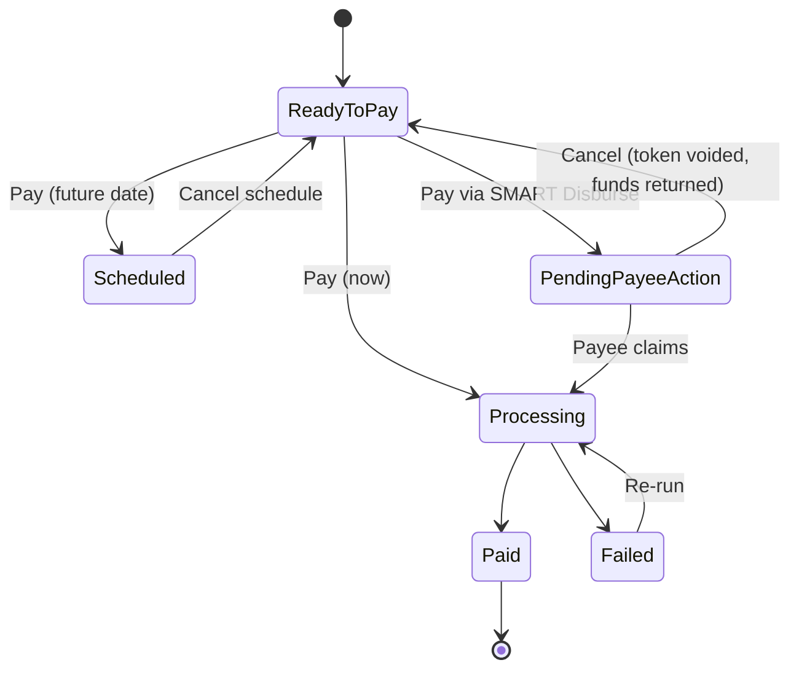

# SMART Hub — current standard (R1.0)

Describes the latest standard release on `main`. Client differences are **not** here; see [variants/](variants/README.md).

> Drafted from the prototype code. Only **Bills & Payables** is documented in detail so far.
> Behavior noted as "prototype" is simulated in the browser and may not match production.

## Modules (Portal shell navigation)

Hub runs in the shared Portal shell. Modules come from `src/scripts/app-plans.js`; which ones a
business sees depends on its plan (`bills-payables` or `full`).

| Module | Capability | Page | Documented |
|---|---|---|---|
| Insights | `insights` | — (placeholder link) | — |
| AP/AR Payments | `ap-ar` | `ap-ar-payments.html` (upgrade page when locked) | TODO |
| **Bills/Payables** | `payables` | `bills-and-payables.html` → `payables-pay.html` | **Yes, below** |
| Vendors | `payables` | `vendors.html`, `vendor-profile.html` | TODO |
| Card Manager | `payables` | — (placeholder) | — |
| Invoices/Receivables (AR) | `receivables` | — (placeholder) | — |
| Customers (AR) | `receivables` | — (placeholder) | — |
| My Company Profile, Settings | `core` | `my-company-profile.html` | TODO |
| Transcard Only (internal admin) | `transcard-admin` | incl. `payment-program-configuration.html` | TODO |

AR (Receivables) has no built pages yet in standard R1.0.

## Bills & Payables

**Page:** `src/pages/dashboard/bills-and-payables.html` · **Script:** `src/scripts/bills-payables-table.js` ·
**Data:** `src/data/bills-payables.json` (table config + bills), `src/data/payees.json`

Title on screen: **Payments Overview**, with a payment count and a **Refresh** button.

### Tabs (one per status)

| Tab | Status key | Row badge(s) shown | Row action |
|---|---|---|---|
| Ready to Pay | `ready_to_pay` | Unprocessed | **Pay** → opens `payables-pay.html?view=pay&id=…&bill=…` |
| In Progress | `in_progress` | Processing · Scheduled · Pending Payee Action (SMART Disburse) | **Cancel** (Scheduled and Pending Payee Action only) |
| Paid | `paid` | Paid | none |
| Exceptions | `exception` | Failed | **Re-run** (confirmation dialog) |

Each tab shows a count. On mobile the tabs become a select.

### Columns

Default columns from `tableConfig.columns`: expand, select, Amount, Bill Reference, Payee, Payment Method,
Source, Due Date, Date Initiated, Payment Date, Status, Failure Reason, action. Some are hidden per tab:

| Tab | Hidden columns | Date shown | Notes |
|---|---|---|---|
| Ready to Pay | Payment Method, Payment Date, Failure Reason | Due Date; Date Initiated opt-in | Selectable rows |
| In Progress | Due Date, Payment Date, select, Failure Reason | Date Initiated | Includes Scheduled payments |
| Paid | Due Date, select, action, Failure Reason | Payment Date (`processedDate`); Date Initiated opt-in | |
| Exceptions | Payment Date, select | Due Date, Date Initiated | Only tab with Failure Reason |

Date rules for all portals: [table filter → Date columns per portal](../../design-system/table-filter.md#date-columns-per-portal).
Manage columns hides Payment Method by default. Date Initiated is on by default on In Progress and Exceptions, and off by default (opt-in) on Ready to Pay and Paid. Those two settings are kept separately.

Users can show or hide columns via **Manage columns** (with "Reset default").
Expanding a row shows details: summary, line items, notes, attachments, activity log.

### Search, filter, export

- **Search** box.
- **Filter**: target is the shared filter. Categories = this table’s column headers, shown only for
  columns the current tab has. See [table filter → Hub AP: Bills & Payables](../../design-system/table-filter.md#smart-hub-ap-bills--payables).
  Categories: Payee, Payment Method, Status, Failure Reason, Due Date, Date Initiated / Payment Date (per tab), Source, each
  only on tabs that have the column. Active filters show as chips; Reset / Apply.
  Remaining gap: the date ranges have no calendar picker yet ([D-09](../../design-system/portal-consistency.md#table-filter)).
- **Export** downloads the current rows as `bills-payables-export.csv`.
- Pagination: 10 / 25 / 50 / 100 per page.

### Values

| Field | Values in standard |
|---|---|
| Payment method | Card (Visa/Mastercard ••••1234), ACH (Bank ••••1234), Wire, **SMART Exchange**, **SMART Disburse** |
| Source | Sage (ERP), QuickBooks Sync, NetSuite Import, Batch Upload, Manual Entry |
| Failure reasons | Approval required, Missing remittance details, Invalid vendor account, Duplicate bill detected |
| Processing steps | Approval queued, Bank verification, Payment processor sync, Release scheduled, Payment completed |
| Currency | USD only in sample data |

### Business rules

- **Re-run** (Exceptions): shows origination account, recipient, amount, payee, method, date and
  failure reason. On confirm, the payment moves to In Progress / Processing, Date Initiated = today,
  and the activity log gets "Re-run confirmed".
- **Cancel scheduled payment**: moves it back to Ready to Pay ("Keep Scheduled" / "Cancel Schedule").
- **Cancel SMART Disburse** (Pending Payee Action): **voids the Disburse token** and moves funds from the
  **Balance Account** back to the origination account. The payment returns to Ready to Pay.
- Prototype: state changes are kept in browser `localStorage` (`bp-row-overrides-v1`), not a backend.

### Status lifecycle

TODO(confirm): the transitions from Pay into Scheduled, Processing or Pending Payee Action, and from
Pending to Processing, are inferred and not yet read from `payables-pay.js`.

## Design vs code gaps (Figma [R2] SH - Accounts Payable)

Things the source-of-truth Figma file has that this code does not. Not standard until built. Listed so agents don’t assume them:

- Payment methods in Figma: ACH, Cross-border Wire, Wire, **Check**, Pay with Card, SMART Disburse, SMART Exchange, **RTP**. Code has card, ACH, wire, SMART Exchange, SMART Disburse.
- Pay modes in Figma: Pay now / Schedule a payment / Pay on Due Date.
- Carry-over not yet in R2 Figma: **Pending Approval** tab with Approve/Decline (Dual Approval file), calendar filter, multi-select, empty state, "Payment re-submitted" modal.
- Known Figma copy bug: the SMART Exchange confirmation modal says "SMART Disburse payment token". Don’t copy it.

## Expanded row: known deviations

The Details section and Activity log differ from Figma and from Consumer Portal (activity icons, standard messages,
empty sections, payment info layout, status badge). See [D-11–D-16](../../design-system/portal-consistency.md#bills--payables-expanded-row-hub-ap).

## Pay flow

`src/pages/dashboard/payables-pay.html` + `src/scripts/payables-pay.js`. Choose origination account
and payment method, then pay or schedule. With SMART Disburse, funds move to the Balance Account first;
after the recipient claims the link they choose how to receive; if unclaimed, funds can be returned.

TODO: document the steps and rules in detail.

## Known limitations

- AR modules (Invoices/Receivables, Customers), Insights and Card Manager are placeholders.
- Prototype data and state live in the browser (see above).
