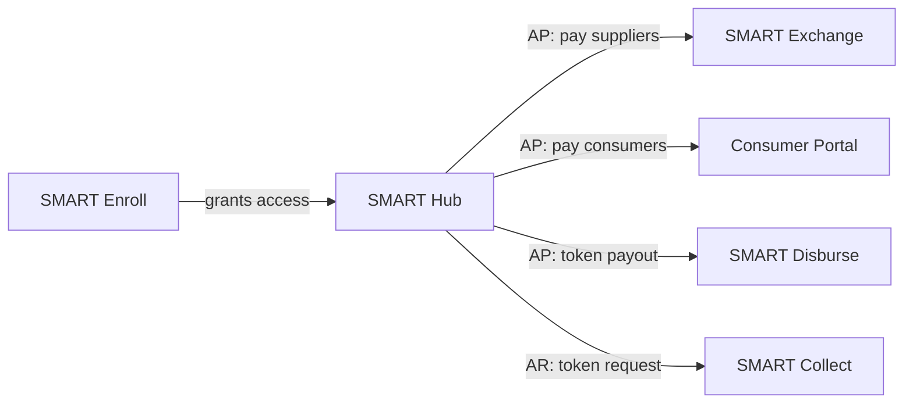

# Integrations between products

How the products interact. If a change touches any row below, check the product on the other end too.

## Map

## Integration table

| ID | From | To | What happens | Data passed | Mechanism | Status |
|---|---|---|---|---|---|---|
| I-01 | Enroll | Hub | A user completes enrollment and gets access to Hub | TODO | TODO (API? shared DB? event?) | confirmed flow, details TODO |
| I-02 | Hub (AP) | Exchange | In Hub's Pay flow, **SMART Exchange** is one of the payment methods. The supplier receives the payment in Exchange | TODO | TODO | confirmed in code (payment method `smart_exchange`) |
| I-03 | Hub (AP) | Consumer Portal | A consumer payment created in Hub can be received in Consumer Portal | TODO | TODO | TODO(confirm): fed by Hub AP? |
| I-04 | Hub (AP) | Disburse | In Hub's Pay flow, **SMART Disburse** is a payment method with one or more payee email destinations. Funds move to a **Balance Account**, a secure link is emailed, and the payee opens the [Disburse flow](../products/smart-disburse/standard.md) and chooses how to receive. Hub shows "Pending Payee Action" until then. Cancelling voids the token and returns the funds | To the email service: payee email, amount, sender, payment reference (bill #), payable id. In the link: `flow`, `email`, and optionally `payableId`, `bill`, `payeeId`, `sender` (read by `sd-onboarding-context.js`) | Email token; test backend `workers/sd-sx-token-service` (`/send-test-token`). Nothing returns to Hub in the prototype. TODO(confirm): real status callback | confirmed in code; link `flow=sd` not recognised by the flow (TODO) |
| I-05 | Hub (AR) | Collect | Hub issues a token; the payer pays via the Collect flow | TODO | TODO | confirmed flow, details TODO |
| I-06 | Exchange (Payment Preferences) | Exchange (Payment Preferences), via email | [STP](../products/smart-exchange/stp.md) opt-in: **Send agreement** emails the Visa AR Manager Participation Agreement to the signer. **Review and sign** links back to the page that sent it, `payment-preferences.html?stpAgreement=review`, which opens the agreement dialog. **No effect on Hub:** no Hub script reads STP state, and card payments from Hub reach Exchange the same way with STP on or off | To the email service: `flow: "stp"`, signer email, signer name (only if it's the profile contact), sender = business name, `verifyBaseUrl`. In the link: `stpAgreement=review`, `email`, `token` (stripped on arrival, never checked) | Email token; test backend `workers/sd-sx-token-service` (`/send-test-token`, `buildAgreementUrl`). Only `allowedTestEmails` get a real email. State stays in the browser (`localStorage`) | confirmed in code; TODO(confirm) what an STP-processed payment should look like in Hub and Exchange |

## Shared in the code

- Hub, Exchange and Consumer Portal share one app shell and a plan system (`src/scripts/app-plans.js`).
  A Supplier Portal business can start a trial that unlocks AP/AR (`upgradeGrants`). This is a path
  from Exchange into Hub. TODO(confirm) that this is intended product behavior.

## Open questions

- TODO: Are there links between the receiving products? For example, can a Disburse recipient
  choose to enroll in Exchange or Consumer Portal instead?
- TODO: Does Enroll also onboard suppliers into Exchange, or only Hub users?
- TODO: Shared services (auth, notifications, payments engine) used by several products.
