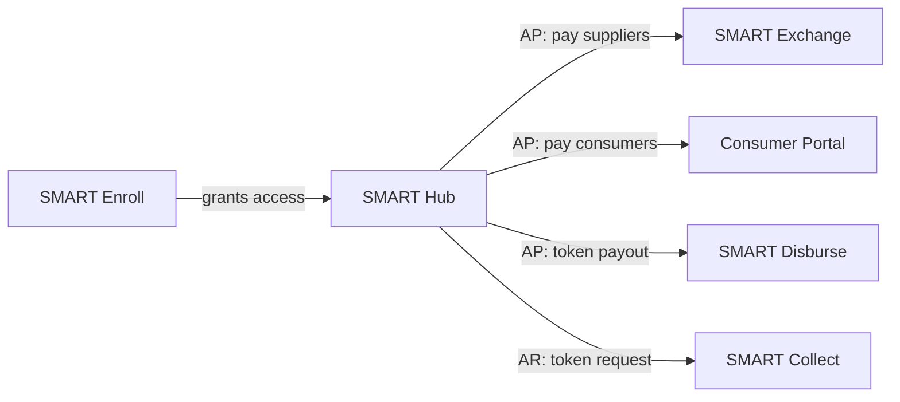

# Integrations between products

How the products interact. If a change touches any row below, check the product on the other end too.

## Map

## Integration table

| ID | From | To | What happens | Data passed | Mechanism | Status |
|---|---|---|---|---|---|---|
| I-01 | Enroll | Hub | A user completes enrollment and gets access to Hub | TODO | TODO (API? shared DB? event?) | confirmed flow, details TODO |
| I-02 | Hub (AP) | Exchange | In Hub's Pay flow, **SMART Exchange** is one of the payment methods. The supplier receives the payment in Exchange | TODO | TODO | confirmed in code (payment method `smart_exchange`) |
| I-03 | Hub (AP) | Consumer Portal | A consumer payment created in Hub can be received in Consumer Portal | TODO | TODO | TODO(confirm): fed by Hub AP? |
| I-04 | Hub (AP) | Disburse | In Hub's Pay flow, **SMART Disburse** is a payment method. Funds move to a **Balance Account**, a token link is emailed, and the recipient claims it and chooses how to receive. Hub shows "Pending Payee Action" until claimed. Cancelling voids the token and returns the funds | TODO | Email token; test backend `workers/sd-sx-token-service` | confirmed in code |
| I-05 | Hub (AR) | Collect | Hub issues a token; the payer pays via the Collect flow | TODO | TODO | confirmed flow, details TODO |

## Shared in the code

- Hub, Exchange and Consumer Portal share one app shell and a plan system (`src/scripts/app-plans.js`).
  A Supplier Portal business can start a trial that unlocks AP/AR (`upgradeGrants`). This is a path
  from Exchange into Hub. TODO(confirm) that this is intended product behavior.

## Open questions

- TODO: Are there links between the receiving products? For example, can a Disburse recipient
  choose to enroll in Exchange or Consumer Portal instead?
- TODO: Does Enroll also onboard suppliers into Exchange, or only Hub users?
- TODO: Shared services (auth, notifications, payments engine) used by several products.
