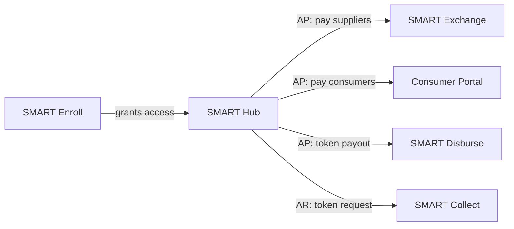

# Suite overview

The SMART suite covers the movement of payments between an organization and the parties it pays
(suppliers, consumers) and the parties that pay it. All products share one design system and one
code repository.

## Products at a glance

| Product | Role in the suite | Primary users | Layout family |
|---|---|---|---|
| **SMART Hub** | The center. Manages Payables (AP: paying out) and Receivables (AR: getting paid). | TODO: e.g. finance / AP-AR teams at the organization | Portal |
| **SMART Enroll** | Onboards users so they can get access to Hub. | TODO: who enrolls? | Enroll |
| **SMART Exchange** | Where **suppliers** (businesses) receive payments. | Suppliers | Portal |
| **Consumer Portal** | Where **consumers** (individuals) receive payments. | Consumers | Portal |
| **SMART Disburse** | Token-based flow to **disburse** (send out) a payment without a full portal. | TODO: payee receiving a token | Token flow |
| **SMART Collect** | Token-based flow to **collect** (request and receive) a payment. | TODO: payer receiving a token | Token flow |

## How they fit together

Details: [integrations.md](integrations.md).

## Layout families

| Family | Products |
|---|---|
| Portal | Hub, Exchange, Consumer Portal |
| Enroll | Enroll (portal, but with its own layout) |
| Token flow | Disburse, Collect |

Details: [layouts.md](layouts.md).
